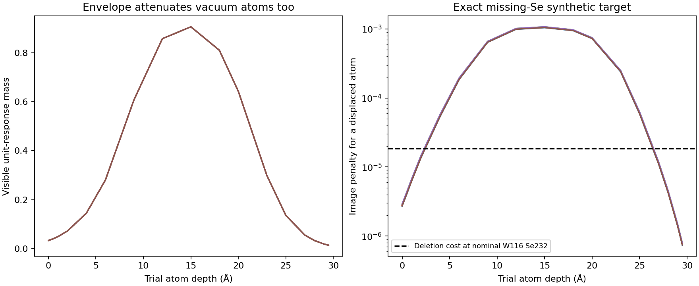

# CPU checks for the 30-slice GA renderer

All checks ran on CPU with CUDA hidden. The production GA code/configuration were not changed in this test. The prototype uses the accepted fixed-0.08 Å XY kernels, flexible depth response, calibrated gain and fixed cutoff. Lateral padding is 7.933328 Å per side; added z padding is zero. The physical cell would be 38.751256 × 38.751256 × 30 Å.

- Saved accepted-renderer replay: maximum voxel difference 7.42e-09 (saved TIFF is float32).
- 10 position/occupancy finite-difference checks passed; largest absolute error 2.35e-12.
- Adding optional 8 Å z padding changes no measured voxel: maximum difference 0. No axial wrapping is used in imaging.
- The aligned reference structure spans z=9.005–20.617 Å, leaving 18.388 Å between outermost atom centers across the periodic z boundary. This is a geometric check, not energy convergence.
- All 6 synthetic single-Se vacancies were identified among all Se deletion candidates at fixed coordinates; selected soft occupancies were recovered with maximum error 1.53e-06.
- The supplied XSF contains 110 W and 238 Se; it is Se-rich relative to 1:2. The current quadratic composition weight 10 gives an incremental objective change of -0.00061163 for removing one Se. Correct synthetic deletion beats the intact candidate with image+composition in 6/6 probes, using image weight 100 and normalized Huber delta 0.2.

The vacuum test exposes a separate issue: an atom moved into the vacuum is itself strongly attenuated by the fitted envelope. For the supplied Se-rich reference, removing one Se reduces the composition penalty, and moving it into vacuum wins in 0/24 probes. Near nominal W116 Se232 stoichiometry, however, the one-Se deletion cost is only 1.84556e-05, yet the residual image cost of a vacuum-displaced Se is smaller in 24/24 probes. The latter comparison uses the same isolated vacancy residual and a nominal stoichiometric count reference; it is a diagnostic of image/composition competition, not an energy evaluation of a new structure. This does not include the energy cost of an isolated atom; FairChem could oppose it. It does show that the image term alone is not a reliable vacuum exclusion mechanism. Optional z confinement remains useful as a diagnostic safeguard and should be judged in the eventual full-energy test.

The 30-slice window can supply the geometric z vacuum without additional padding. The cutoff envelope stays fixed in experimental coordinates. Atomic positions/occupancies remain differentiable (piecewise at interpolation knots). The apparent z thickness of a blurred blob does not determine the physical vacuum separation of the atomic structure.

Detailed gradient, synthetic-vacancy, real-data deletion and vacuum-scan CSVs are saved alongside `results.json`. Real-data deletion changes are screening diagnostics, not vacancy identifications. No physical energy, atomic relaxation, or complete GA was evaluated; FairChem/ASE are absent from this test environment.

Reproduce: `CUDA_VISIBLE_DEVICES='' OPENBLAS_NUM_THREADS=1 /data2/jt577/ws11_venv/bin/python run_cpu_tests.py`.
